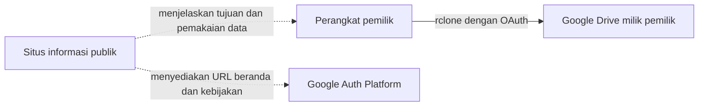

# Situs Informasi Publik OAuth Pondasi Kode

Repository publik ini menjadi sumber situs GitHub Pages tingkat organisasi di
[pondasi-kode.github.io](https://pondasi-kode.github.io/).

## Tujuan dan peran

Situs ini adalah halaman identitas dan kebijakan publik untuk OAuth desktop client
`Pondasi Kode rclone`. Client itu perkakas internal yang dipakai pemilik Pondasi Kode untuk
mencadangkan, memeriksa, dan memulihkan berkas kerja antara perangkatnya sendiri dan Google Drive
miliknya sendiri.

Situs ini hanya menjelaskan integrasi tersebut. Ia tidak menjadi perantara transfer berkas, tidak
menerima token OAuth, dan tidak mengakses Google Drive. Situs ini bukan toko dan bukan dokumentasi
produk Pondasi Kode.

## Mengapa repository ini publik

Google Cloud Console tidak mengizinkan sebuah aplikasi OAuth eksternal dipindahkan ke status
`In production` tanpa URL beranda dan URL kebijakan privasi. Selama aplikasi berstatus `Testing`,
refresh token habis dalam tujuh hari, sehingga backup berhenti bekerja seminggu kemudian.

GitHub Pages tingkat organisasi pada GitHub Free memerlukan repository publik. Karena itu repository
ini menjadi pengecualian sempit yang disengaja dari kebijakan Pondasi Kode bahwa semua repository
private. Client-nya sendiri tetap aplikasi pemakaian internal yang belum diverifikasi; situs ini bukan
bukti bahwa verification Google sudah selesai.

## Isi repository

| Path | URL publik | Peran |
|---|---|---|
| `index.html` | `/` | Identitas aplikasi, tujuan, dan alur datanya dalam bahasa sederhana |
| `privacy.html` | `/privacy.html` | Akses, pemakaian, penyimpanan, pembagian, retensi, dan kendali data pengguna Google |
| `terms.html` | `/terms.html` | Ketentuan pemakaian internal dan batas layanan |
| `assets/style.css` | tidak berlaku | Tampilan bersama saja; tanpa pelacak dan tanpa script |
| `.nojekyll` | tidak berlaku | Menyajikan berkas statis tanpa proses build Jekyll |

## Batas informasi publik

Repository ini hanya memuat teks kebijakan untuk publik dan aset tampilan statis. Ia tidak boleh
memuat:

- OAuth client ID atau client secret;
- access token, refresh token, atau `rclone.conf`;
- detail Akun Google atau informasi kontak pribadi;
- source code, dokumen kerja, histori chat, riset, atau berkas backup Pondasi Kode;
- analytics, pelacak iklan, formulir login, atau formulir pengumpulan data.

## Pemeliharaan

Teks publik berbahasa Indonesia. Kode, nama berkas, URL, scope API, serta nama resmi produk dan
kebijakan dipertahankan dalam bentuk aslinya.

Isi beranda, kebijakan privasi, konfigurasi branding di Google Auth Platform, dan perilaku rclone yang
sebenarnya harus selalu sejalan. Kebijakan diperbarui lebih dulu, baru scope atau cara pemakaian data
pengguna Google diubah. Setiap tautan diperiksa secara lokal, lalu perubahan di-commit dan di-push ke
`main`; GitHub Pages menerbitkannya sesudah itu.
